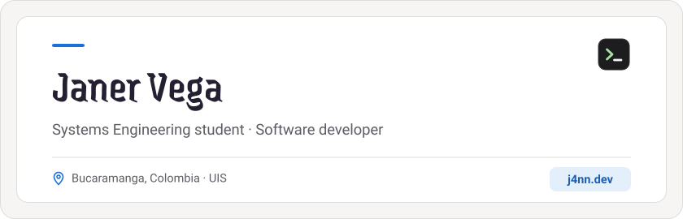

  <a href="https://www.j4nn.dev" target="_blank" rel="noopener noreferrer">
    <picture>
      <source media="(prefers-color-scheme: dark)" srcset="./assets/hero-dark.svg" />
      <source media="(prefers-color-scheme: light)" srcset="./assets/hero-light.svg" />
      
    </picture>
  </a>

 

### About

- Final-year **Systems Engineering** student at **Universidad Industrial de Santander (UIS)** in Bucaramanga, Colombia, with hands-on experience in software development, QA, and systems administration.
- Currently working as a **QA Analyst** at UIS — previously **Front-end Developer** (Angular) and **Systems Administrator** (OpenStack private cloud research on Ubuntu).
- Over **6 years using Linux** as a daily driver — comfortable in the terminal and container workflows.
- **3rd place nationwide** in *"Datos a la U"* (MinTIC, 2024).
- Always looking for an excuse to grab a cup of coffee ☕️

---

### Projects

| Project | Overview | Stack |
| :--- | :--- | :--- |
| **[j4nn.dev](https://www.j4nn.dev)** | Bilingual (EN / ES) personal portfolio with prerendering and adaptive GNOME/Adwaita light & dark themes. | `Angular 22` · `Taiga UI` · `TypeScript` |
| **[COMA](https://www.j4nn.dev/#projects)** | Institutional platform for UIS faculties (*Calumet R&D group*) managing theses, news, and communications; migrating from legacy Java/JSP to a modular monolith. | `Java` · `JSP` · `Spring Boot` · `React` · `Docker` |
| **[SentIA](https://www.j4nn.dev/#projects)** | Backend API and data layer for an AI-based emotional support chatbot. | `Python` · `FastAPI` · `Firebase` |

---

### Tech Stack

**Languages**

**Frameworks**

**Databases**

**Tools & DevOps**

---

### Connect

